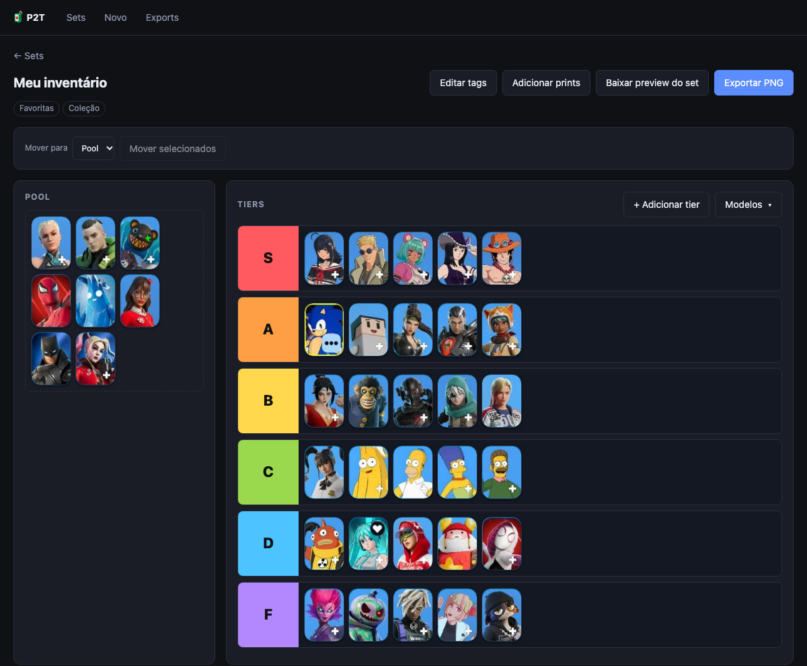
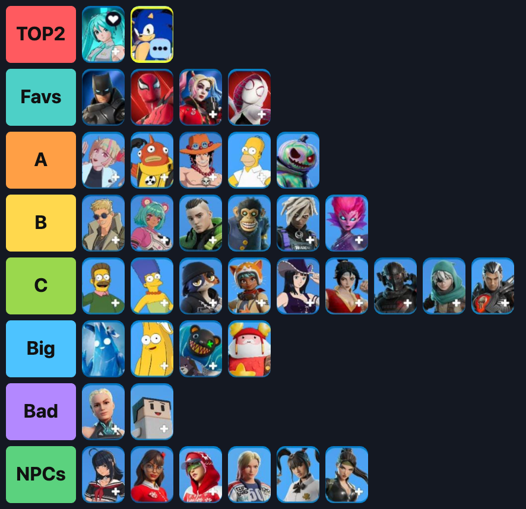
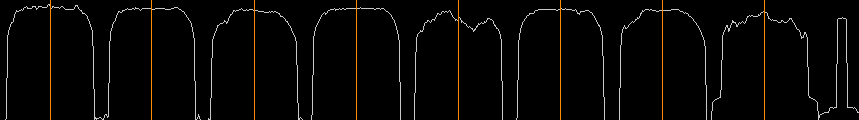
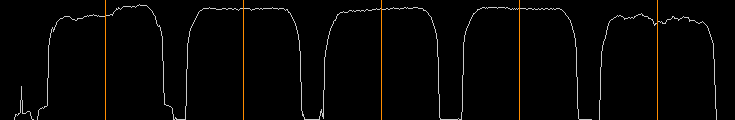
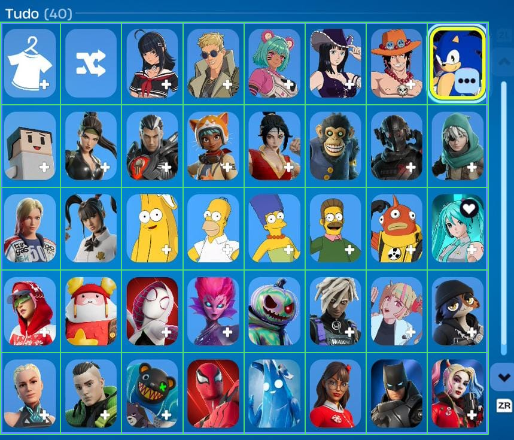
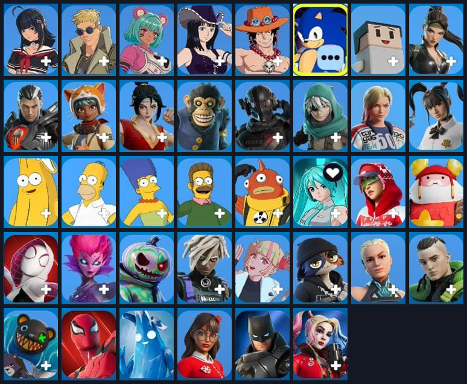

# Print → Tierlist

Turn inventory screenshots into a tier list you can organize, revisit, and share as a PNG. Print → Tierlist detects the grid in each screenshot, cuts it into individual cards, and combines cards from multiple screenshots into one set.



## Make your first tier list

1. Open [index.html](index.html) in a browser and choose **Novo set**. You can try it with the [sample inventory screenshot](test/sample.jpeg).
2. Select or drop one or more screenshots. If a screenshot includes menus or other content outside the inventory, use **Recortar print** to mark the area to scan. Open **Ajustar grade manualmente** to override the detected grid.
3. Remove any cards you want to leave out, then save the set. Drag cards into a tier or select several and move them together. Use **Adicionar prints** to bring in more cards later.
4. Choose **Exportar PNG** when the ranking is ready. Open the export by clicking its card on the **Exports** page, then view it at original size or download it.



## Organize and reuse your rankings

- **Find sets quickly.** Add tags such as `Favoritas` or `Temporada 1`, then search by name or tag on the **Sets** page.
- **Reuse a tier layout.** In **Modelos**, save your tier names, colors, and order, then load them into another set.
- **Clean up imports.** Select and remove unwanted cards before saving. **Desfazer remoção** restores the last group you removed.

The app runs in the browser. Sets, tier templates, and exports are stored locally in that browser.

## Grid detection example

The detector looks for the gaps between inventory tiles. It analyzes the selected crop, or the entire screenshot when no crop is set, at up to 900 pixels wide.

1. **Estimate the gap color.** Sample a three-pixel border, group RGB values into buckets of eight levels per channel, and take the most frequent bucket. Pixels at least 70 units away in RGB distance become tile candidates in a binary mask.
2. **Project the mask onto each axis.** Average the mask down each column to get the X projection and across each row to get the Y projection. Peaks indicate tile bands. Dips indicate gaps.

**X projection · finding columns**



**Y projection · finding rows**



3. **Find tile centers.** Smooth each projection, then take contiguous runs above the midpoint between the smoothed minimum and maximum. Discard runs shorter than 40% of the median run width. The orange lines mark the centers of the remaining runs.
4. **Turn centers into cuts.** Place each interior cut halfway between neighboring centers. Estimate the outer cuts using half the median center spacing, then map the grid back to the original image. Slice each cell with a small inset and skip low-color tiles that look like interface icons.

| Grid mapped onto the sample | Cards extracted from the grid |
| --- | --- |
|  |  |

To regenerate these images, run the [Python detector](test/detect.py) with NumPy and Pillow installed.

```bash
python3 test/detect.py
```

See [Architecture](ARCHITECTURE.md) for how the browser app and detector harness fit together.
